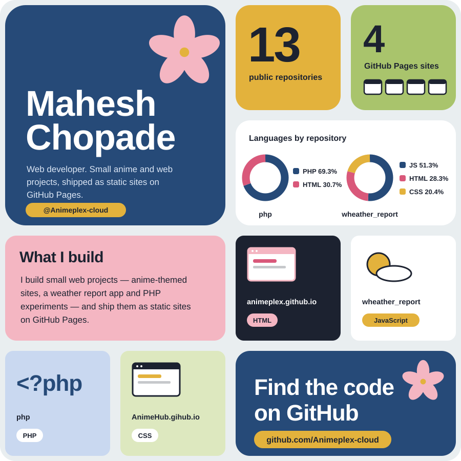
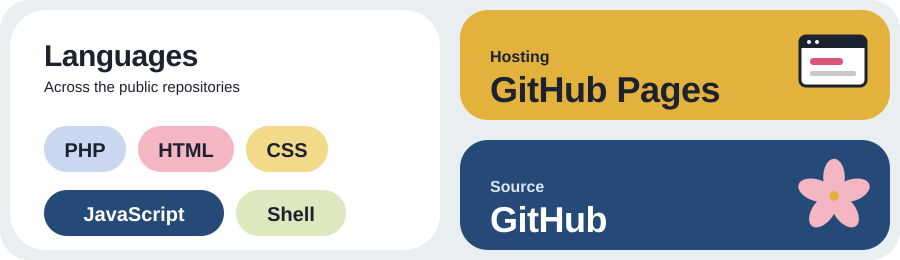
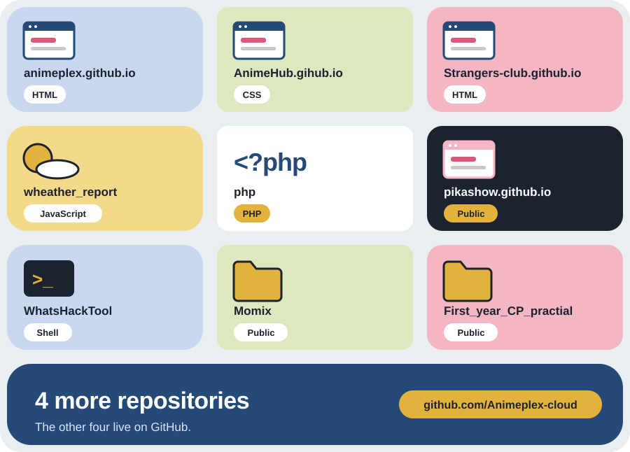

**Open a repository**

- [animeplex.github.io](https://github.com/Animeplex-cloud/animeplex.github.io)
- [AnimeHub.gihub.io](https://github.com/Animeplex-cloud/AnimeHub.gihub.io)
- [wheather_report](https://github.com/Animeplex-cloud/wheather_report)
- [php](https://github.com/Animeplex-cloud/php)

