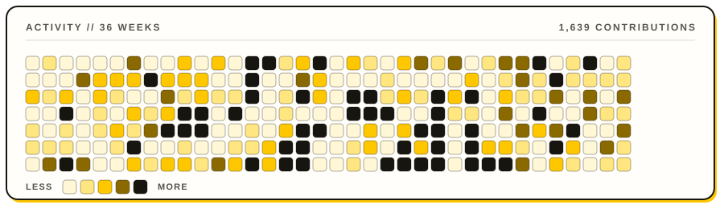
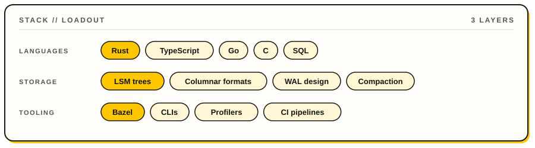
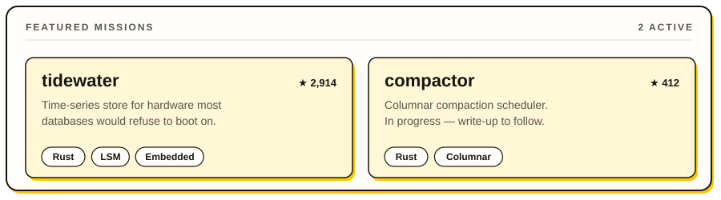
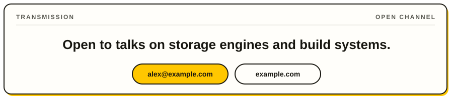

**Alex Rivera** · Systems engineer. I build storage engines and the tools around them.

[Visit example.com](https://example.com) · [Email Alex](mailto:alex@example.com)

**Mission brief.** I work on the boring, load-bearing parts of software — storage, build systems, and the protocols in between. Lately that means **tidewater**, a time-series store that runs on hardware most databases would refuse to boot on.

**Current objective.** Writing a columnar compaction scheduler and a long post about why it was harder than expected.

## Telemetry

## Activity

## Stack

## Featured projects

- [View tidewater on GitHub](https://github.com/sample-user/tidewater)
- [View compactor on GitHub](https://github.com/sample-user/compactor)

## Contact

