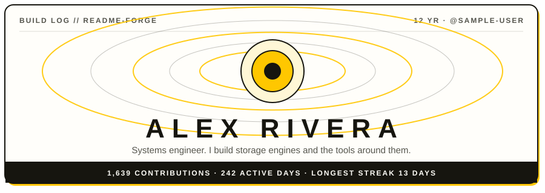
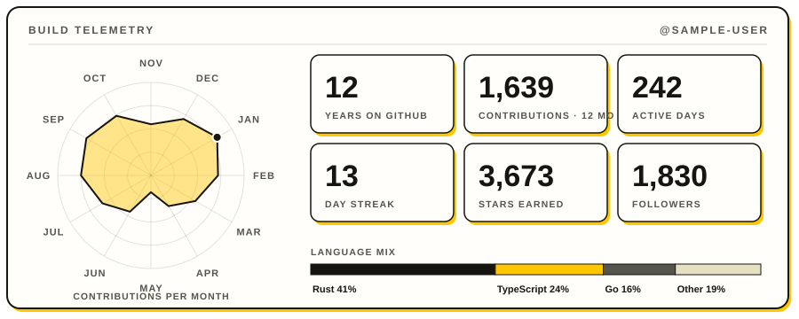

Alex Rivera · Systems engineer. I build storage engines and the tools around them.
Visit example.com · Email Alex

Mission brief. I work on the boring, load-bearing parts of software — storage, build systems, and the protocols in between. Lately that means tidewater, a time-series store that runs on hardware most databases would refuse to boot on.
Current objective. Writing a columnar compaction scheduler and a long post about why it was harder than expected.
Telemetry

Stack
Layer	Tools
Languages	Rust, TypeScript, Go
Storage	LSM trees, columnar formats, WAL design
Tooling	Build systems, CLIs, profilers
Featured projects
tidewater — Time-series store for constrained hardware.
compactor — Columnar compaction scheduler (in progress).
Contact
Open to talks about storage engines and build systems. Email Alex or visit example.com.
